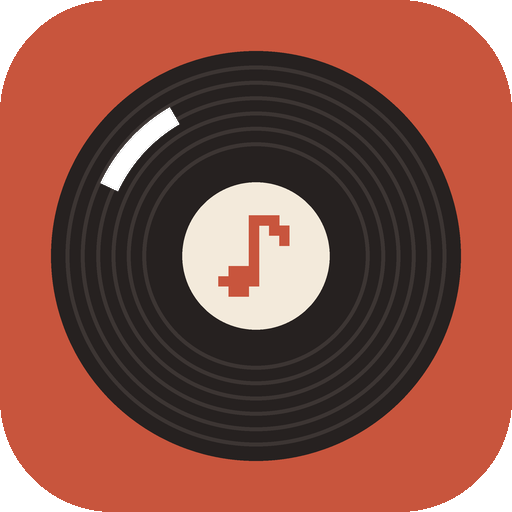
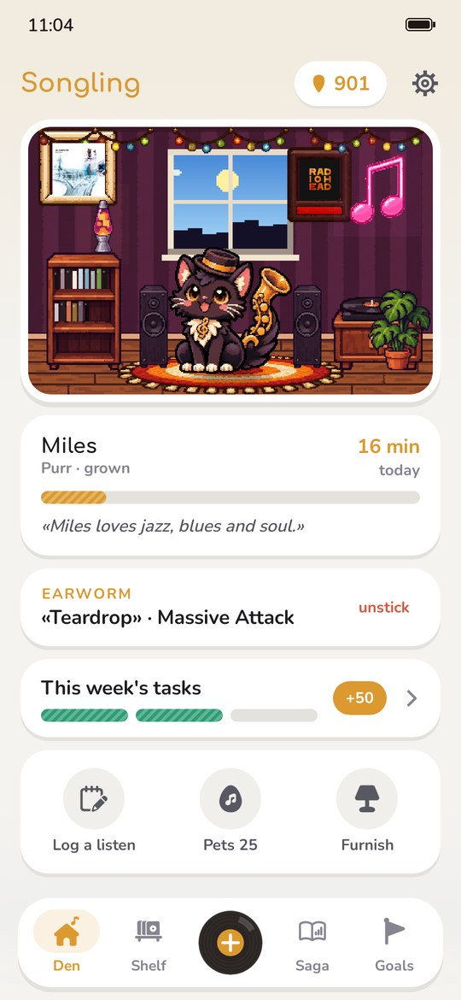
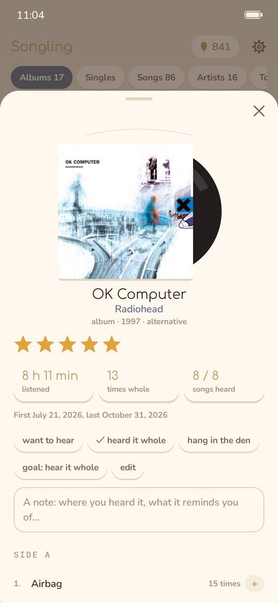
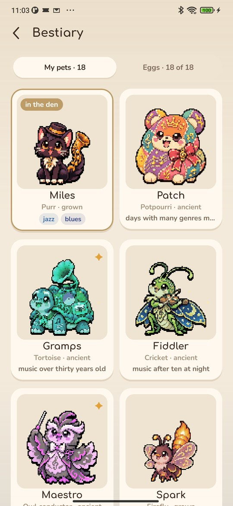
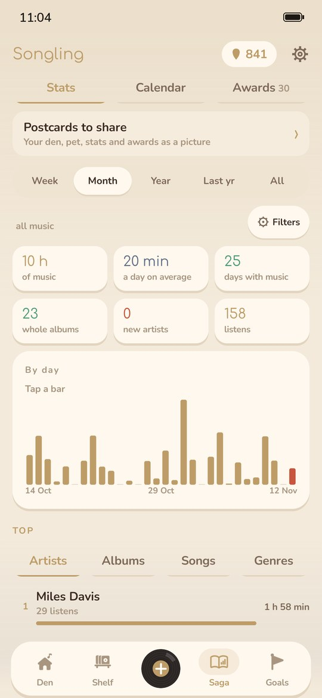

<div align="center">



# Songling

### A pet that listens to music with you

*Play music in any player and your pet hears it, dances and grows. Plus a shelf of albums, stats, goals and a den to furnish. Free, no ads, no account.*

[](https://github.com/bigdevwhale/songling/actions/workflows/android.yml)
[](https://github.com/bigdevwhale/songling/releases/latest)


[](LICENSE)

**English** · [Русский](README.ru.md) · [Website](https://bigdevwhale.github.io/stillcraft/apps/songling/) · [Changelog](CHANGELOG.md)

   

**[Download APK](https://github.com/bigdevwhale/songling/releases/latest/download/Songling.apk)** · Android 9+

</div>

---

## Your pet hears the music

Songling sees what plays in Spotify, YouTube Music, Apple Music or any other player, so there's nothing to log. Android asks you to give it notification access for that; Songling takes just the song, the artist and the album. A song counts after 30 seconds, and podcasts are left out. You choose which apps it hears: every player but a few, or only the ones you play music in, so video and social apps don't count.

A record, the radio or a concert can be logged by hand – a whole album or a single song.

## 25 pets

There are three eggs to start with. The rest are found by the way you listen: hours of rock or jazz, music at night or in the morning, artists from many countries, long sittings, a song on repeat, a live concert.

- An egg hatches after three hours of music, then the pet grows: baby, youngster, grown, ancient.
- Each has its favourite music. It feeds the pet one and a half times as much and pays double plectrums.
- Each has a nature: a greedy one grows faster, a curious one earns a plectrum for every new artist.
- A grown pet takes one of six forms for good, by the music it was raised on.
- Days without music wind it down until it stops like a clockwork toy. A couple of songs and it dances again.

## The den

Your pet lives in a pixel room and dances while music plays: it nods to rock and sways slowly to ambient. Plectrums are the money here, paid for music, whole albums, tasks and goals. They buy a turntable, a record shelf, fairy lights, a disco ball and a dozen more things, each tried in the room first. Two frames on the wall hold posters: your favourite album and a band. And the window shows the weather and the time of day in your town.

## The shelf

Everything you've heard – albums, singles, songs and artists – with covers, genres, years and stars. A «to hear» list keeps what you never get round to. Add an album or a song yourself, from search or typed in, and make genres of your own, like «for work» or «grandma's records».

## Saga and goals

Stats for a week, a month, a year and all time: top artists, albums, songs and genres, your hours and weekdays, countries and decades. A calendar shows every day of the year.

Set goals on anything: «4 new albums this month», «10 hours of Radiohead this year», «music from three new countries». And every week brings three small tasks for plectrums.

70 awards with steps to climb – hours, streaks, night listening, songs by two artists, New Year songs and more – each step paying plectrums. And postcards for a social feed: the den, the pet, your month, top artists and albums, genres, the year as squares, awards and all your pets, as a post or a story.

## Records or tapes

Albums look like records in sleeves or like tapes with hand-written J-cards – chosen on first start and in Settings. There's a light and a dark theme and a few pixel backgrounds. A home-screen widget shows what plays as a record or a tape, with previous, play/pause and next.

## History and backups

Bring your history over from Spotify, Last.fm or ListenBrainz. Everything stays on the phone; a backup is one zip file. The app only goes online for covers, genres and artists' countries (iTunes, MusicBrainz, Deezer) and for the weather (Open-Meteo, MET Norway).

## Build

```bash
git clone https://github.com/bigdevwhale/songling.git
cd songling
./gradlew assembleDebug
./gradlew assembleDebug -Pdemo -Pdemolang=en   # app.songling.demo: four months of music and all 18 pets
```

Needs JDK 17+ (Android Studio's bundled JBR works) and the Android SDK. Kotlin, Jetpack Compose, Room, DataStore. The pets are painted by `tools/pets.py`, the icon by `tools/icon.py`, the screenshots by `tools/capture.sh`.

Songling is part of [Stillcraft](https://bigdevwhale.github.io/stillcraft/), a series of small free apps. MIT licensed. Fonts Comfortaa, Nunito, Caveat and IBM Plex Mono are under the OFL.
