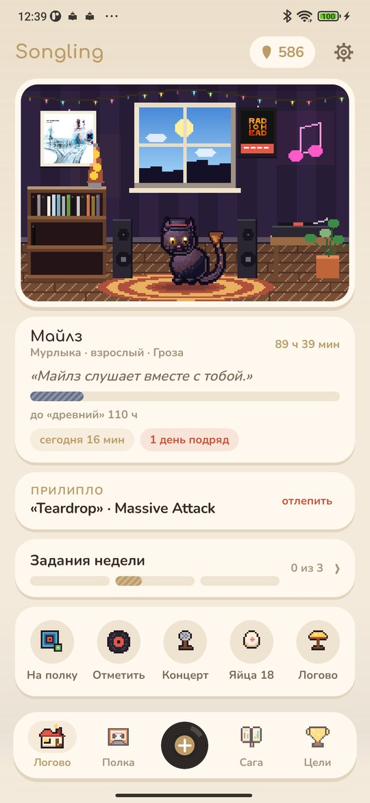
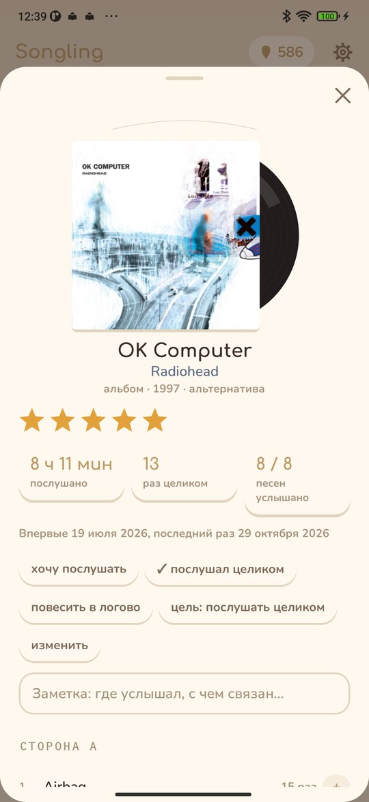
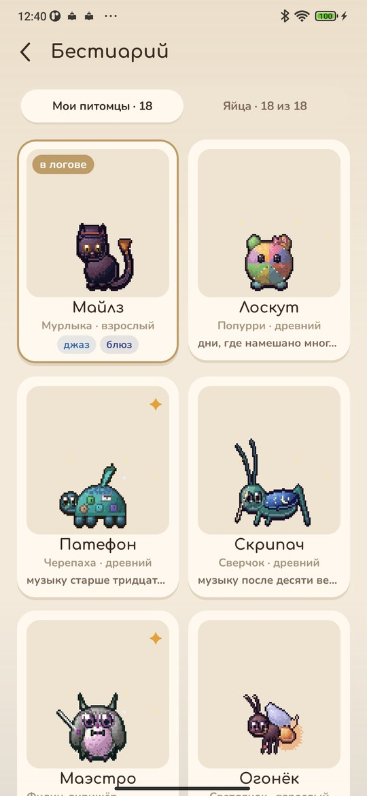
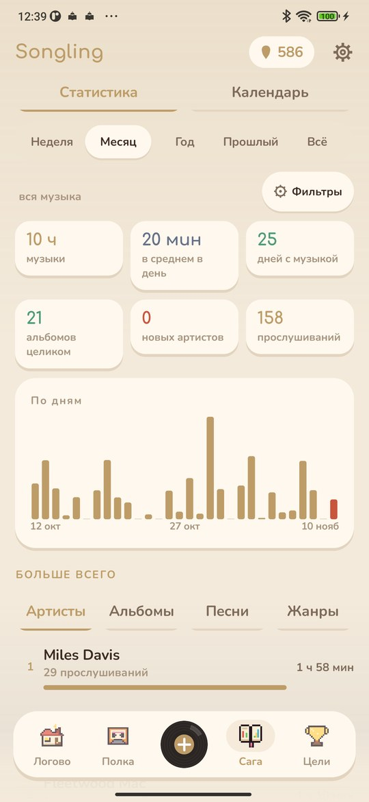

<div align="center">


# Songling

### Питомец, который слушает с вами музыку

*Слушайте музыку в любом плеере – питомец её услышит, будет танцевать и расти. А ещё полка с альбомами, статистика, цели и логово, которое можно обставить. Бесплатно, без рекламы и регистрации.*

[](https://github.com/bigdevwhale/songling/actions/workflows/android.yml)
[](https://github.com/bigdevwhale/songling/releases/latest)


[](LICENSE)

[English](README.md) · **Русский** · [Сайт](https://bigdevwhale.github.io/stillcraft/apps/songling/) · [Изменения](CHANGELOG.md)

   

**[Скачать APK](https://github.com/bigdevwhale/songling/releases/latest/download/Songling.apk)** · Android 9+

</div>

---

## Питомец слышит музыку

Songling видит, что играет в Spotify, Яндекс Музыке, YouTube Music, VK и любом другом плеере, так что отмечать ничего не нужно. Для этого Android просит дать приложению доступ к уведомлениям. Songling берёт оттуда только название песни, артиста и альбом. Песня засчитывается через 30 секунд, подкасты не считаются.

Пластинку, радио или концерт можно отметить вручную – альбом целиком или отдельную песню.

## 18 питомцев

Сначала на выбор три яйца. Остальные находятся по тому, как вы слушаете: часы рока или джаза, музыка по ночам или по утрам, артисты из разных стран, долгие сессии, песня на повторе, живой концерт.

- Яйцо вылупляется через три часа музыки. Дальше питомец растёт: малыш, подросток, взрослый, древний.
- У каждого своя любимая музыка. На ней питомец растёт в полтора раза быстрее, а медиаторов за неё дают вдвое больше.
- У каждого свой характер: обжора растёт быстрее, любопытный получает медиатор за каждого нового артиста.
- Выросший питомец навсегда принимает одну из шести форм – смотря какой музыкой его кормили.
- Если несколько дней не слушать музыку, у питомца кончается завод, и он замирает. Пара песен – и он снова танцует.

## Логово

Питомец живёт в пиксельной комнате и пляшет, когда играет музыка: под рок кивает в такт, под эмбиент медленно покачивается. Медиаторы – здешняя монета: их дают за музыку, альбомы целиком, задания и цели. На них в комнату можно купить проигрыватель, полку пластинок, гирлянду, диско-шар и ещё десяток вещей – каждую сначала можно примерить. На стене две рамки для постеров: обложка любимого альбома и группа. А за окном та же погода и то же время суток, что сейчас у вас в городе.

## Полка

Всё, что вы слушали: альбомы, синглы, песни и артисты, с обложками, жанрами, годами и звёздами. Для того, до чего никак не доходят руки, есть список «Хочу послушать». Альбом или песню можно добавить и самому: найти через поиск или вписать вручную. Можно завести свои жанры, например «для работы» или «бабушкины пластинки».

## Сага и цели

Статистика за неделю, месяц, год и всё время: топы артистов, альбомов, песен и жанров, любимые часы и дни недели, страны и десятилетия. Календарь показывает каждый день года.

Цели ставятся на что угодно: «4 новых альбома за месяц», «10 часов Radiohead в этом году», «музыка из трёх новых стран». А каждую неделю появляются три задания за медиаторы.

## Пластинки или кассеты

Альбомы выглядят как пластинки в конвертах или как кассеты с подписанными от руки вкладышами – это выбирается при первом запуске и в настройках. Есть светлая и тёмная тема и несколько пиксельных фонов.

## История и копии

Историю прослушиваний можно перенести из Spotify, Last.fm и ListenBrainz. Всё хранится в телефоне, резервная копия – один zip-файл. В сеть приложение ходит только за обложками, жанрами и странами артистов (iTunes, MusicBrainz, Deezer) и за погодой (Open-Meteo, MET Norway).

## Сборка

```bash
git clone https://github.com/bigdevwhale/songling.git
cd songling
./gradlew assembleDebug
./gradlew assembleDebug -Pdemo -Pdemolang=ru   # app.songling.demo: четыре месяца музыки и все 18 питомцев
```

Нужны JDK 17+ (подойдёт JBR из Android Studio) и Android SDK. Kotlin, Jetpack Compose, Room, DataStore. Питомцы рисуются скриптом `tools/pets.py`, иконка – `tools/icon.py`, скриншоты – `tools/capture.sh`.

Songling – часть [Stillcraft](https://bigdevwhale.github.io/stillcraft/), серии небольших бесплатных приложений. Лицензия MIT. Шрифты Comfortaa, Nunito, Caveat и IBM Plex Mono – OFL.
